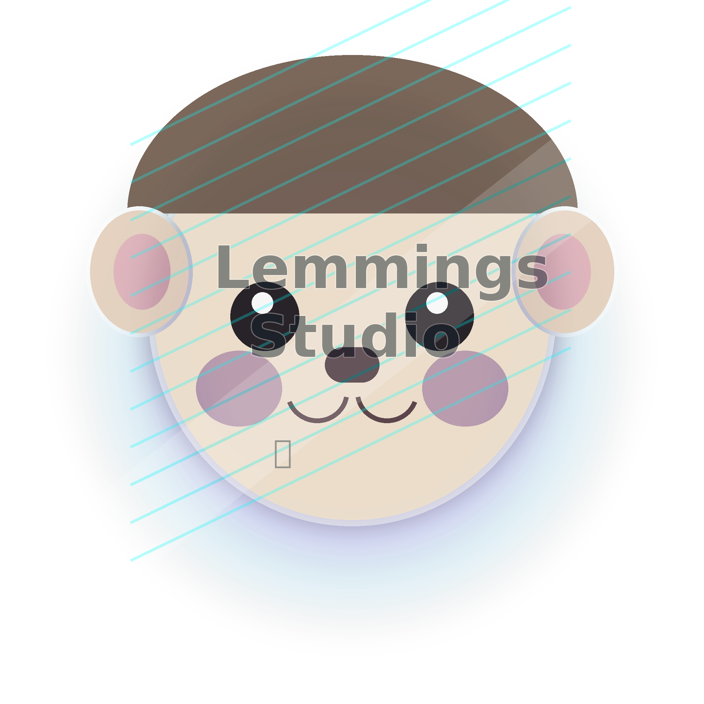

<p align="center">
  
</p>

<h1 align="center">LemmingsStudio</h1>

<p align="center">
  A chaotic, AI-assisted, cross-platform DAW experiment by MagmaVance LLC.
</p>

<p align="center">
  <strong>macOS beta available now.</strong><br />
  Windows support is in active parity work. Linux support is planned after Windows stabilizes.
</p>

---

## What is LemmingsStudio?

LemmingsStudio is an experimental music-production workstation built around familiar DAW workflows, stock instruments/effects, automation, audio/MIDI editing, sample workflows, and agentic music-production ideas.

The project started as a “what if I just built the thing?” experiment and has grown into a real beta app with macOS support and an actively developing Windows port.

LemmingsStudio is still beta software. Expect rough edges, especially around third-party plug-ins, backend setup, and platform-specific audio/MIDI behavior.

## Current feature highlights

- Arrangement View
- Step Sequencer workflows
- Piano Roll editing
- Audio clips and MIDI clips
- Stock instruments, including Oscillatron and LemmingBass
- Stock effects and device rack workflows
- Track, clip, device, tempo, and VST3 automation paths
- Bounce/freeze/export workflows
- Audio recording and MIDI recording on Windows parity builds
- WASAPI/WinMM recording paths on Windows
- AU plug-in hosting on macOS
- Native VST3 hosting work-in-progress on Windows
- Splice integration experiments
- Discord Rich Presence
- Agentic music-production features
- Experimental stem-splitting/model-backed workflows where supported

## Downloading binaries

Large binary builds are not intended to live in this Git repository.

GitHub repositories are best kept source-only for this project because the packaged app bundles, model caches, ffmpeg binaries, Python backends, and installer artifacts can become very large.

Planned binary distribution strategy:

- GitHub repository: source code, scripts, docs, issues, and roadmap.
- GitHub Releases: small release notes and links where possible.
- External hosting: large `.dmg`, `.exe`, model-pack, and full-fat installer downloads.

Current public Mac beta link:

```text
https://bit.ly/LemmingsStudioMac-Beta1
```

Project/demo video:

```text
https://www.youtube.com/watch?v=Y3yoBzyWPgw
```

## Repository layout

```text
.
├── Sources/LemmingsStudio/          # Main Swift/macOS app source
├── Ports/Windows/                   # Windows port, installer scripts, native helper projects
├── Scripts/                         # macOS helper/build scripts
├── Docs/                            # Build notes, parity notes, backend notes, historical patch notes
├── Package.swift                    # Swift package definition
├── build.sh                         # macOS build helper
└── LemmingsStudioSplash.png         # README splash image
```

## macOS build instructions

### Requirements

- macOS on Apple Silicon is recommended.
- Xcode command-line tools.
- Swift toolchain included with Xcode.
- Optional: Carla/Homebrew dependencies if testing plug-in bridge workflows.
- Optional: Python/ML dependencies if testing backend stem/model features.

Install Xcode command-line tools:

```bash
xcode-select --install
```

### Build

From the repository root:

```bash
chmod +x ./build.sh
./build.sh
```

For direct SwiftPM builds:

```bash
swift build -c release
```

Depending on the current build script revision, the packaged app output may be placed under `.build/`, `dist/`, or a script-created release folder. Check the terminal output after the build completes.

### macOS bundle metadata

The current app metadata uses:

```text
Bundle identifier: com.magmavance.LemmingsStudio
Version: 1.1
```

## Windows build instructions

The Windows build lives under:

```text
Ports/Windows
```

### Requirements

- Windows 10/11.
- .NET SDK 8.
- PowerShell.
- Inno Setup 6 for installer builds.
- Visual Studio 2022 Build Tools with Desktop C++/CMake components if building the native VST3 helper.
- Internet access during first build if the script needs to download ffmpeg, VC++ redistributable, JUCE, Python, or model/backend assets.

Recommended Windows x64 build command:

```powershell
cd Ports\Windows
./build-windows.ps1 -Backend cpu -Runtime win-x64 -BundleModels -RequireNativeVst3Host
```

Native Windows ARM64 build command:

```powershell
cd Ports\Windows
./build-windows.ps1 -Backend cpu -Runtime win-arm64
```

Important: the native `win-arm64` build intentionally disables some Demucs/stem-splitting paths because the Windows ARM64 Python audio/ML ecosystem does not currently provide all required wheels reliably. Use the `win-x64` build under Windows-on-ARM emulation for fuller backend compatibility.

### Useful Windows build flags

```powershell
-SkipFfmpeg
-FfmpegSource "C:\Path\To\ffmpeg.exe"
-BundleModels
-ModelNames htdemucs
-RequireNativeVst3Host
-SkipNativeVst3Host
-SkipNativeVst3ToolchainBootstrap
-NativeVst3HostPath "C:\Path\To\LemmingsVst3Host.exe"
```

### Installer output

Windows build artifacts are usually written under:

```text
Ports/Windows/artifacts/
```

The exact installer path is printed by the build script after packaging completes.

## Large files and release assets

Do not commit generated app bundles, installers, `.dmg` files, model caches, Python environments, or generated media into the repository.

Suggested pattern:

```text
GitHub repo       → source code only
GitHub Releases   → release notes + small assets + external download links
External storage  → large DMG/EXE/model-pack downloads
```

Good candidates for external hosting:

- Mac `.dmg` installers
- Windows `.exe` installers
- full-fat Windows builds with Python/PyTorch/Demucs caches
- optional RVC/model packs
- generated splash/video assets if they become large

## Current Windows parity status

The Windows port is being developed toward macOS feature parity, with recent work focused on:

- Step Sequencer and Piano Roll workspaces
- Audio recording
- MIDI recording polish
- WASAPI/WinMM capture
- expressive MIDI events such as pitch bend and mod wheel
- startup splash/sound polish
- export diagnostics
- native VST3 host helper work

Some areas may still require validation on real Windows hardware/VMs, especially third-party VST3 behavior, audio-interface behavior, and backend ML dependency setup.

## Known beta caveats

- Third-party plug-in behavior may vary by vendor and platform.
- Windows VST3 hosting is under active development and should be tested plug-in by plug-in.
- Some ML/audio features depend on large Python/PyTorch/Demucs/RVC dependencies.
- Native Windows ARM64 support is improving, but x64 remains the safer target for full backend compatibility.
- The chatbot/model integration is still early; other agentic features are further along.

## Contributing

Contributions, bug reports, test reports, and platform-specific fixes are welcome once the project is published.

Useful issue reports should include:

- OS version and architecture
- LemmingsStudio version/build
- exact build command used
- audio interface/MIDI device details if relevant
- plug-in name/version/path if relevant
- logs or screenshots
- steps to reproduce

## License

License information should be finalized before public source release. Add the project license file at the repository root before accepting external contributions.

## Copyright

© MagmaVance LLC. All rights reserved.
